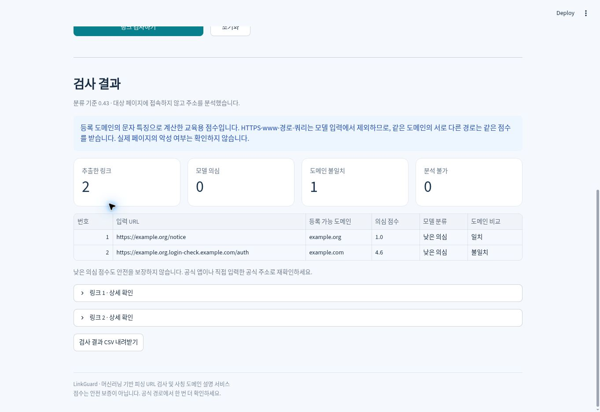

# LinkGuard

**머신러닝 기반 피싱 URL 검사 및 사칭 도메인 설명 서비스**

URL이나 문자 내용을 붙여넣으면 URL 문자열을 분석하고, 학습 모델의 피싱 의심 점수와 공식 도메인 비교 결과를 보여주는 기말 프로젝트입니다. URL 검사 과정에서 대상 웹사이트에 접속하지 않습니다.

> **평가 해석:** 정상 샘플이 모두 HTTPS이고 경로·쿼리가 비어 있는 수집 편향을 확인했습니다. 이 형식만으로 판정하는 지름길을 줄이기 위해 현재 모델은 등록 가능 도메인의 철자·숫자 등 문자열 특징만 사용합니다. HTTP/HTTPS, `www`, 경로·쿼리는 모델 입력에서 제외하고 URL 구조 관찰에서 별도로 설명합니다. 모델 점수는 교육용 분석 결과이며 운영 보안 판정으로 사용할 수 없습니다. 자세한 결과는 [모델 보고서](docs/model-report.md)를 확인하세요.

## 실행 화면



예약 도메인을 사용한 실제 실행 화면입니다. 모델 점수가 낮아도 도메인 불일치를 따로 확인할 수 있습니다.

## 주요 기능

| 기능 | 설명 |
| --- | --- |
| URL 검사 | 공개 데이터로 학습한 모델을 이용해 URL별 피싱 의심 점수 계산 |
| 공식 도메인 비교 | 등록 가능 도메인을 표시하고 사용자가 알고 있는 공식 도메인에 속하는 호스트인지 비교 |
| 한국어 설명 | 실제 호스트, 하위 도메인, 사용자 정보 구문 등 관찰 결과 안내 |
| 문자 속 링크 추출 | 문자에서 HTTP/HTTPS 링크를 추출해 여러 주소를 검사 |
| 탐지 민감도 비교 | 검증 데이터에서 판정 기준에 따른 오탐·미탐 변화 확인 |
| 모델 성능 비교 | 숫자 특징 로지스틱 회귀·랜덤 포레스트와 문자 TF-IDF 로지스틱 회귀의 실제 측정 결과 비교 |

**모델 점수와 규칙 기반 관찰 결과는 별도로 표시합니다.** 공식 도메인 불일치만으로 피싱을 확정하지 않습니다.

## 빠른 실행

Python 3.12를 권장합니다. 모델 아티팩트가 저장소에 포함되어 있으므로 앱을 실행하기 위해 먼저 학습할 필요는 없습니다.

### Windows PowerShell

Python 3.12와 Python Launcher(`py`)가 설치되어 있으면 프로젝트의 `run_windows.bat`를 실행할 수도 있습니다. 이 파일은 가상환경 생성, 의존성 설치, 앱 실행을 순서대로 수행합니다. 직접 명령을 실행하려면 다음을 사용합니다.

```powershell
git clone https://github.com/hurmin13/linkguard.git
cd linkguard
python -m venv .venv
.\.venv\Scripts\python.exe -m pip install -r requirements.txt
.\.venv\Scripts\python.exe -m streamlit run app.py
```

가상환경 활성화 명령이나 PowerShell 실행 정책 변경 없이 가상환경의 Python을 직접 실행합니다.

### macOS / Linux

```bash
git clone https://github.com/hurmin13/linkguard.git
cd linkguard
python3 -m venv .venv
.venv/bin/python -m pip install -r requirements.txt
.venv/bin/python -m streamlit run app.py
```

실행 후 브라우저에서 `http://localhost:8501`을 엽니다. 이미 해당 포트를 사용 중이면 실행 명령 끝에 `--server.port 8502`를 추가합니다.

## 사용 예시

**URL 검사**에서 아래 예시 문자를 붙여넣고, 공식 도메인 입력란에 `example.org`를 넣습니다.

```text
[교육용 예시]
안내 주소: https://example.org/notice
확인이 필요한 주소: https://example.org.login-check.example.com/auth
```

위 주소는 구조 설명용 예약 도메인 예시입니다. 실제 피싱 사례나 모델 성능 증명용 샘플이 아닙니다. 두 번째 주소에 `example.org`라는 문자열이 있어도 등록 가능 도메인은 `example.com`입니다.

자세한 설명은 [사용 매뉴얼](docs/user-guide.md), 발표 순서는 [시연 대본](docs/demo-script.md)을 참고하세요.

## 데이터와 모델

- 데이터: [UCI PhiUSIIL Phishing URL (Website)](https://archive.ics.uci.edu/dataset/967/phiusiil+phishing+url+dataset)
- 원본 규모: 정상 URL 134,850건 / 피싱 URL 100,945건
- 원본 라벨: `1 = 정상`, `0 = 피싱`; 모델 내부에서는 피싱을 양성 클래스로 관리합니다.
- 라이선스: CC BY 4.0. 원본 출처와 인용을 보존합니다.
- 입력 특징: 등록 가능 도메인에서 계산한 숫자 특징과 문자 2~5글자 조합의 TF-IDF를 각각 사용한 모델을 비교합니다. 문자 모델은 도메인 철자의 부분 문자열 패턴을 학습합니다. URL의 스킴, 하위 도메인, 경로, 쿼리 형식과 웹페이지 HTML 기반 원본 특징은 모델에 넣지 않습니다.
- 같은 등록 가능 도메인이 학습·검증·최종 평가에 겹치지 않도록 그룹 단위로 분리합니다.
- 각 학습 실행에서 모델 선택과 판정 기준은 검증 데이터로 정하고 별도 평가 분할의 성능을 계산합니다. 개발 중 수집 편향을 발견해 특징 범위를 수정한 뒤 같은 평가 분할을 다시 사용했으므로, 보고값은 개발 반복 후의 내부 평가이며 완전히 새로운 외부 검증이 아닙니다.
- 모델은 JSON 형식으로 저장하며 사용자 업로드 모델이나 pickle 파일을 실행하지 않습니다.

실제 처리 건수, 분할 감사 결과, 모델별 성능, 최종 선택 근거는 [모델 보고서](docs/model-report.md)와 [측정 결과](artifacts/metrics.json)에 기록됩니다. 원본 건수와 실제 학습에 사용한 건수는 전처리로 달라질 수 있습니다.

현재 포함된 모델은 **문자 TF-IDF 로지스틱 회귀**이며 기본 판정 기준은 **0.43**입니다. 내부 평가에서 F1 **0.8032**, 정밀도 **86.37%**, 재현율 **75.07%**, 정상 URL 오탐률 **8.83%**를 측정했습니다. 이는 세 번째 개발 반복에서 같은 내부 평가 분할로 얻은 결과이며 새로운 외부 검증 결과는 아닙니다.

### 재학습

```powershell
.\.venv\Scripts\python.exe -m scripts.download_data
.\.venv\Scripts\python.exe -m scripts.train
```

다운로드는 공식 UCI 제공처에서만 수행합니다. 원본 CSV와 다운로드 파일은 Git에서 제외합니다. 옵션과 출처는 [데이터 안내](data/README.md)를 참고하세요.

## 검증

```powershell
.\.venv\Scripts\python.exe -m pip install -r requirements-dev.txt
.\.venv\Scripts\python.exe -m pytest
```

macOS/Linux에서는 `.\.venv\Scripts\python.exe` 대신 `.venv/bin/python`을 사용합니다. URL의 실제 호스트 해석, 도메인 경계, 잘못된 입력, 모델 아티팩트와 화면 동작을 확인합니다.

## 프로젝트 구성

| 경로 | 역할 |
| --- | --- |
| `app.py` | Streamlit 웹앱 |
| `run_windows.bat` | Windows에서 가상환경 준비 후 앱 실행 |
| `linkguard/` | URL 파싱, 특징 추출, 모델 추론, 검사 서비스 |
| `scripts/` | 공개 데이터 다운로드 및 모델 학습 |
| `artifacts/` | JSON 모델, 성능 결과, 검증 데이터의 임계값별 결과 |
| `tests/` | 핵심 기능과 앱 동작 검증 |
| `docs/` | 개발 계획, 사용 매뉴얼, 모델 보고서, 시연 대본 |
| `data/README.md` | 데이터 출처와 이용 안내 |

## 범위와 한계

- 학습용 URL 분류 도구입니다. 낮은 의심 점수가 사이트의 안전을 보장하지 않습니다.
- 모델 점수는 보정된 피해 발생 확률이 아닙니다.
- 링크를 열거나 웹페이지, 리다이렉션 목적지, 인증서, DNS, 도메인 등록일을 검사하지 않습니다. 단축 URL의 최종 목적지도 확인하지 않습니다.
- 문자 전체의 사기 여부가 아니라 추출된 URL을 검사합니다.
- 공식 서비스가 외부 인증·결제 도메인을 사용할 수도 있으므로 불일치는 추가 확인 대상으로 안내합니다.
- 같은 등록 가능 도메인이면 경로·쿼리·HTTP/HTTPS가 달라도 모델 점수는 같습니다. 정상 도메인의 침해나 특정 경로의 악성 동작을 탐지하는 모델이 아닙니다.
- URL 구조 관찰은 설명 규칙의 결과이며 개별 모델 예측의 인과적 설명이 아닙니다.
- 공개 과거 데이터의 측정 성능은 최신 피싱이나 실제 사용 환경의 성능을 보장하지 않습니다.
- 입력은 앱 세션에서 처리합니다. 실제 문자나 인증 토큰이 포함된 URL을 공개 저장소·공유 화면에 올리지 마세요.

## 출처

Prasad, A. & Chandra, S. (2024). *PhiUSIIL Phishing URL (Website)* [Dataset]. UCI Machine Learning Repository. https://doi.org/10.1016/j.cose.2023.103545

- [scikit-learn](https://scikit-learn.org/stable/)
- [Streamlit](https://docs.streamlit.io/)
- [tldextract](https://github.com/john-kurkowski/tldextract)
- [Public Suffix List](https://publicsuffix.org/)
